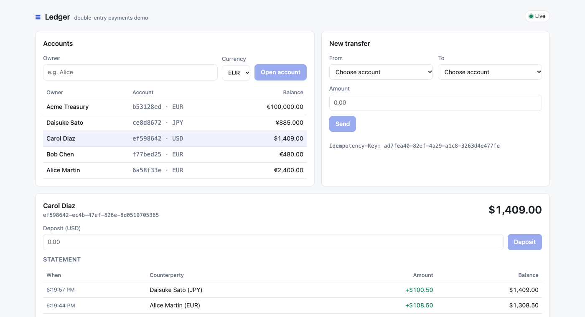
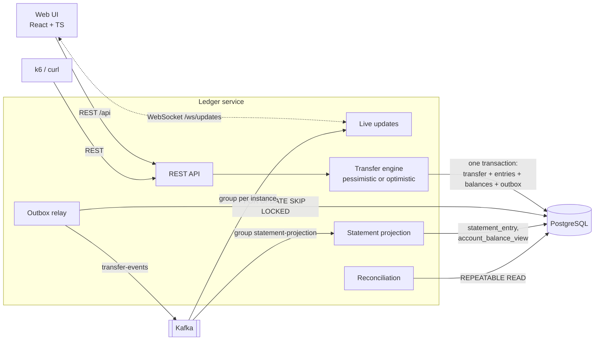
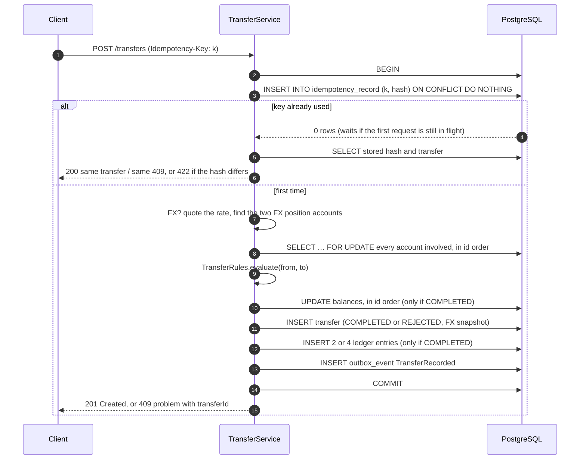
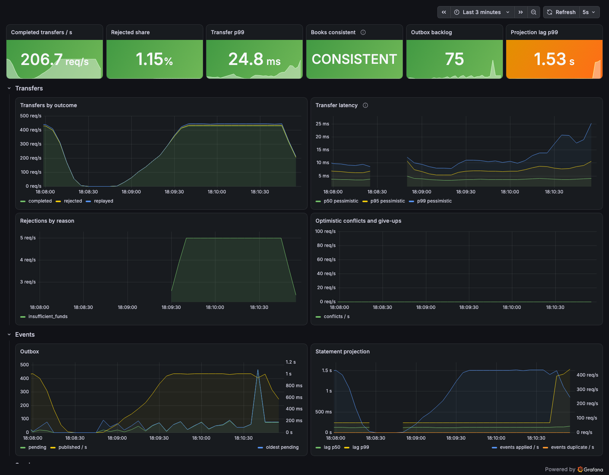

# Ledger Service

[](https://github.com/ilia-muravev-dev/ledger/actions/workflows/ci.yml)


[](LICENSE)

A small double-entry payments ledger that focuses on the parts of money movement that are easy to get
wrong: **correctness under concurrency, idempotent APIs, double-entry bookkeeping, reliable event
publishing** and an independent way to prove the books still balance.

> [!NOTE]
> This is a learning / portfolio project, not a production system. There is no authentication,
> no multi-tenancy and no regulatory tooling. See [What I would change for real scale](#what-i-would-change-for-real-scale).



## Contents

- [Quick start](#quick-start)
- [Architecture](#architecture)
- [API](#api)
- [Invariants](#invariants)
- [How a transfer works](#how-a-transfer-works)
- [Design decisions](#design-decisions)
- [Pessimistic vs optimistic locking: benchmark](#pessimistic-vs-optimistic-locking-benchmark)
- [Load test and observability](#load-test-and-observability)
- [Testing](#testing)
- [What I would change for real scale](#what-i-would-change-for-real-scale)
- [Project layout](#project-layout)
- [Roadmap](#roadmap)

## Quick start

Requirements: Docker. For development also JDK 21 and Node 24.

```bash
docker compose up --build
```

| | URL |
|---|---|
| Web UI | http://localhost:8081 |
| REST API | http://localhost:8080 |
| PostgreSQL | `localhost:5432` (`ledger` / `ledger`) |
| Kafka | `localhost:29092` |

Add Prometheus (`:9090`) and Grafana (`:3000`, dashboard **Ledger overview**, anonymous viewer):

```bash
docker compose --profile observability up --build
```

Development:

```bash
./gradlew build          # compile + all backend tests (Testcontainers: PostgreSQL + Kafka, needs Docker)
./gradlew bootTestRun    # run the service against throwaway PostgreSQL and Kafka containers
./gradlew benchmark      # locking strategy benchmark, writes build/reports/benchmark/locking.md
./gradlew postgresMultixactRepro   # reproduces the PostgreSQL bug from #26 with plain JDBC
```

```bash
cd ui && npm ci && npm run dev    # UI on :5173, proxies /api and /ws to :8080
```

```bash
k6 run load/k6/transfers.js       # load test against http://localhost:8080 (BASE_URL to override)
```

Select the transfer engine with `LEDGER_LOCKING=pessimistic|optimistic` (default `pessimistic`).

## Architecture



The write side (`account`, `transfer`, `ledger_entry`) is the source of truth and is only changed inside
the transfer transaction. Everything downstream — the Kafka topic, the statement read model, the live
WebSocket feed — is derived from the outbox and can be rebuilt by replaying it.

## API

All amounts are integers in **minor units** of the currency (cents for EUR/USD, yen for JPY).

| Method | Path | Description |
|---|---|---|
| `POST` | `/accounts` | Open a customer account `{owner, currency}` |
| `GET` | `/accounts?limit=&cursor=` | Customer accounts, newest first, keyset pagination |
| `GET` | `/accounts/{id}` | Account with its current balance (write side) |
| `POST` | `/accounts/{id}/close` | Close an account with a zero balance (idempotent) |
| `POST` | `/accounts/{id}/deposits` | Fund an account from the settlement account. Requires `Idempotency-Key` |
| `GET` | `/accounts/{id}/entries?limit=&cursor=` | Ledger entries from the write side, newest first |
| `GET` | `/accounts/{id}/statement?limit=&cursor=` | Statement from the read model: counterparty, transfer type, running balance |
| `POST` | `/transfers` | Move money. `targetCurrency` makes it an FX transfer. Requires `Idempotency-Key` |
| `GET` | `/transfers/{id}` | A transfer, completed or rejected, with its FX snapshot |
| `GET` | `/fx/rates?from=&to=` | Current rate for a currency pair |
| `WS` | `/ws/updates` | Send `{"type":"subscribe","accountIds":[…]}`, receive `entry-posted` messages for those accounts with the balance after each entry |
| `GET` | `/actuator/reconciliation` | Recompute every balance from the entries and report discrepancies |
| `GET` | `/actuator/prometheus` | Metrics |

### Example session

```bash
curl -s -X POST localhost:8080/accounts \
  -H 'Content-Type: application/json' \
  -d '{"owner":"Alice","currency":"EUR"}'
```

```json
{"id":"89d9f70d-9726-458f-b024-076997cc179c","owner":"Alice","currency":"EUR","type":"CUSTOMER","status":"ACTIVE","balance":0,"createdAt":"2026-11-08T09:23:01.949639Z"}
```

Fund it (money enters the ledger from the EUR settlement account, see [settlement accounts](#settlement-accounts)):

```bash
curl -s -X POST localhost:8080/accounts/$ALICE/deposits \
  -H 'Content-Type: application/json' -H 'Idempotency-Key: dep-1' \
  -d '{"amount":10000,"currency":"EUR"}'
```

Transfer €25.00 to Bob:

```bash
curl -s -i -X POST localhost:8080/transfers \
  -H 'Content-Type: application/json' -H 'Idempotency-Key: t-1' \
  -d "{\"fromAccountId\":\"$ALICE\",\"toAccountId\":\"$BOB\",\"amount\":2500,\"currency\":\"EUR\"}"
```

```http
HTTP/1.1 201
Location: http://localhost:8080/transfers/cc09b34d-a1a5-4272-8ba9-7c5580b17094

{"id":"cc09b34d-a1a5-4272-8ba9-7c5580b17094","type":"TRANSFER","fromAccountId":"89d9f70d-…","toAccountId":"395b1dcf-…","amount":2500,"currency":"EUR","status":"COMPLETED","createdAt":"2026-11-08T09:23:02.416407Z"}
```

Sending the exact same request again returns `200` with the same transfer; no money moves. Reusing the
key with a different body:

```http
HTTP/1.1 422
Content-Type: application/problem+json

{"type":"/problems/idempotency-key-reused","title":"Idempotency key was used with a different request","status":422,"detail":"Idempotency key 't-1' was already used with a different request","instance":"/transfers","idempotencyKey":"t-1"}
```

Spending more than the balance:

```http
HTTP/1.1 409
Content-Type: application/problem+json

{"type":"/problems/insufficient-funds","title":"Insufficient funds","status":409,"detail":"Transfer 2026d96f-… was rejected: INSUFFICIENT_FUNDS","instance":"/transfers","transferId":"2026d96f-…","reason":"INSUFFICIENT_FUNDS"}
```

€100.00 from a EUR account to a USD account:

```bash
curl -s -X POST localhost:8080/transfers \
  -H 'Content-Type: application/json' -H 'Idempotency-Key: fx-1' \
  -d "{\"fromAccountId\":\"$ALICE\",\"toAccountId\":\"$CAROL\",\"amount\":10000,\"currency\":\"EUR\",\"targetCurrency\":\"USD\"}"
```

```json
{"id":"…","type":"TRANSFER","amount":10000,"currency":"EUR","status":"COMPLETED","fx":{"targetAmount":10850,"targetCurrency":"USD","rate":1.085000000000,"rateSource":"static-config","quotedAt":"…"},"createdAt":"…"}
```

Statement from the read model:

```bash
curl -s "localhost:8080/accounts/$ALICE/statement?limit=1"
```

```json
{"accountId":"f04c3d31-…","currency":"EUR","balance":7500,"lastEntryId":3,"projectedAt":"…","items":[{"entryId":3,"transferId":"d2eb2c6f-…","transferType":"TRANSFER","counterpartyAccountId":"4a26b52c-…","amount":-2500,"currency":"EUR","balanceAfter":7500,"postedAt":"…"}],"nextCursor":"ZTE6Mw"}
```

Reconciliation:

```bash
curl -s localhost:8080/actuator/reconciliation
```

```json
{"checkedAt":"2026-11-08T09:23:02.614851Z","consistent":true,"accountsChecked":3,"transfersChecked":3,"balanceMismatches":[],"unbalancedCurrencies":[],"malformedTransfers":[]}
```

### Errors

Every error is an [RFC 7807](https://www.rfc-editor.org/rfc/rfc7807) problem (`application/problem+json`) with a stable `type`:

| Status | `type` | When |
|---|---|---|
| 400 | `/problems/validation-failed` | Malformed body, missing or oversized `Idempotency-Key`, amount ≤ 0, `from = to`, unknown currency, bad cursor, an FX amount worth less than one minor unit |
| 404 | `/problems/account-not-found`, `/problems/transfer-not-found` | Unknown id |
| 409 | `/problems/insufficient-funds` | Balance lower than the amount |
| 409 | `/problems/account-closed` | Either account is `CLOSED` |
| 409 | `/problems/currency-mismatch` | Accounts in different currencies without `targetCurrency`, or a target that does not match the destination |
| 409 | `/problems/fx-rate-unavailable` | No rate for the currency pair |
| 409 | `/problems/settlement-account-not-allowed` | A customer transfer touching a system account |
| 409 | `/problems/account-not-empty` | Closing an account with money on it |
| 422 | `/problems/idempotency-key-reused` | Same key, different request |
| 503 | `/problems/contention` | Optimistic engine ran out of retries; `Retry-After: 1` |

## Invariants

Each invariant is enforced in code, backed by a database constraint where possible, and has tests on
real PostgreSQL.

| # | Invariant | Enforced by | Tested in |
|---|---|---|---|
| 1 | Every completed transfer creates exactly two entries (four for FX) that sum to zero per currency; rejected transfers create none | `Posting.forTransfer` / `forFxTransfer` | `TransferInvariantsIT`, `FxTransferIT`, reconciliation |
| 2 | The sum of all entries is zero per currency | double entry + settlement and FX position accounts | `TransferInvariantsIT`, `TransferConcurrencyContract`, reconciliation |
| 3 | A customer balance never goes below zero | `TransferRules` on locked / versioned rows; `account_balance_check` | `TransferInvariantsIT`, 100-thread drain test |
| 4 | Transfers only between `ACTIVE` accounts in the same currency (or with an explicit `targetCurrency`), amount > 0, `from ≠ to` | `TransferRules`, `TransferCommand`; `transfer_amount_check`, `transfer_distinct_accounts_check`, `transfer_fx_check` | `TransferRulesTest`, `TransferCommandTest`, `TransferInvariantsIT`, `FxTransferIT`, `SchemaConstraintsIT` |
| 5 | The same idempotency key never moves money twice and always returns the original result | key claimed first under a unique index | `IdempotencyIT`, 20-thread same-key test, k6 retry scenario |
| — | Cached balance = sum of the account's entries | balances only change in the transfer transaction | `TransferInvariantsIT`, `ReconciliationIT`, every concurrency test, scheduled reconciliation |
| — | Every recorded transfer is published, and projected exactly once | outbox in the same transaction; `processed_event` dedupe | `OutboxIT`, `StatementProjectionIT` |

## How a transfer works



## Design decisions

### Money in minor units

`Money` is a `long` number of minor units plus a `java.util.Currency`. There is no `double`, `float` or
`BigDecimal` in the money path, so there is no rounding to reason about, and arithmetic uses
`Math.addExact` and friends so an overflow throws instead of wrapping into a negative balance.
`BigDecimal` appears only for FX rates and to format amounts for humans. The UI does the same: amounts
typed by the user are parsed as strings straight into integer minor units (`"0.29"` → `29`).

### Balances are derived from entries

The source of truth is `ledger_entry`: append-only, signed amounts, debit negative, credit positive.
`account.balance` is a cache that only changes inside the same transaction that writes the entries,
which makes `GET /accounts/{id}` and the overdraft check O(1) without trusting the cache blindly:
reconciliation recomputes every balance from the entries in a single `REPEATABLE READ` snapshot and
also checks the per-currency zero sum and the shape of every transfer. It runs on demand
(`/actuator/reconciliation`) and every five minutes, exported as `ledger_reconciliation_consistent`.

### Settlement accounts

A closed ledger cannot create money, yet accounts need funding. Deposits are ordinary transfers from a
per-currency `SETTLEMENT` account — a system account allowed to go negative. Its balance is the mirror
image of all customer money in that currency, so "all entries sum to zero" holds at all times.
Customer transfers may not touch system accounts.

### Rejected transfers are recorded

A transfer that fails a business rule (insufficient funds, closed account, currency mismatch, no FX
rate) is stored as `REJECTED` with a reason and the API answers `409` with its `transferId`. Without
that, a client retrying a failed payment after the account was topped up would silently get a
*successful* payment for the same idempotency key. Validation errors (`400`) and unknown accounts
(`404`) are not recorded and do not consume the key.

### Idempotency: claim the key first

`idempotency_record` has the key as its primary key. The transfer transaction starts with
`INSERT … ON CONFLICT DO NOTHING`. If another transaction holding the same key has not committed yet,
PostgreSQL makes the insert **wait on the unique index** until it commits or rolls back — so two
concurrent requests with the same key serialise on the key alone, never both proceed, and the loser
reads the winner's result. A SHA-256 of the canonical request (type, accounts, amount, currency, target
currency) detects key reuse with a different body (`422`). Claiming the key before taking account
locks means duplicate retries do not queue behind traffic on hot accounts.

### Lock ordering

The pessimistic engine locks every account a transfer touches with `SELECT … FOR UPDATE` in a global
order (by id) — two for a plain transfer, four for an FX transfer. A→B and B→A therefore always lock the
same row first and can never wait on each other in a cycle. Removing the ordering makes
`opposingTransfersDoNotDeadlock` and `opposingFxTransfersDoNotDeadlock` fail with PostgreSQL
`deadlock detected`; removing `FOR UPDATE` makes the 100-thread drain test overdraw — both checked
while writing the tests.

### Optimistic alternative

`OptimisticTransferEngine` reads the accounts without locks and applies `UPDATE … WHERE version = ?`
to customer accounts in the same id order. Zero rows updated means someone else got there first: the
whole transaction is rolled back and retried with exponential backoff and full jitter, up to
`max-attempts` (default 30), after which the API answers `503` with `Retry-After`. Retries hold no
database connection while sleeping.

The versioned updates run **before** the transfer and its entries are inserted. The first version did
it the other way round and, under contention, a few transactions per run failed inside PostgreSQL with
`XX000 new multixact has more than one updating member`. That is a known PostgreSQL bug, not an
application error: when a row carries `KEY SHARE` locks (here from the foreign keys of the inserted
entries) and the transaction that updated it is still in the middle of aborting (here a loser of the
version check), the next updater fails. It is fixed upstream by
[068c9aa](https://github.com/postgres/postgres/commit/068c9aaec31b) (October 2026, backpatched to
14–18), which is not yet in a released minor version — 16.15 and 18.6 are both affected.

`MultixactReproTest` reproduces it with plain JDBC, without any application code:

| PostgreSQL | Order | Foreign keys | Multixact errors per run |
|---|---|---|---:|
| 16.15 | inserts, then versioned updates | on | 3–4 |
| 18.6 | inserts, then versioned updates | on | 4–11 |
| 16.15 / 18.6 | versioned updates, then inserts | on | 0 |
| 18.6 | inserts, then versioned updates | off | 0 |

Updating first means a transaction only key-shares rows it already holds an update lock on, so the
race cannot happen, and a losing attempt aborts before writing anything. Run it with
`./gradlew postgresMultixactRepro`; details in [#26](https://github.com/ilia-muravev-dev/ledger/issues/26).

### Transactional outbox

Publishing to Kafka from the request thread after commit would lose events on a crash, and publishing
before commit would announce transfers that then roll back. Instead the transfer transaction inserts a
`TransferRecorded` event into `outbox_event`, and `OutboxRelay` publishes it:

- every 200 ms it takes a batch of unpublished events with `FOR UPDATE SKIP LOCKED` (so several
  instances can relay in parallel without stepping on each other), sends them with an idempotent
  producer and `acks=all`, waits for the acks and marks them published — all in one DB transaction;
- the topic is keyed by transfer id; one event carries both (or all four) entries of a transfer and the
  balance after each one;
- this is **at-least-once**: a crash between the Kafka ack and the commit sends the batch again.

### Read model that tolerates duplicates and reordering

`StatementProjection` builds `statement_entry` and `account_balance_view` from the topic. It does not
rely on exactly-once delivery or on ordering:

- **duplicates:** `processed_event (consumer, event_id)` is inserted in the same transaction as the
  projection, and statement lines are keyed by ledger entry id;
- **reordering:** the balance view keeps the balance of the *highest entry id* it has seen. Entry ids
  per account grow in commit order because both engines serialise writers on the account row, so the
  view converges whatever order events arrive in;
- **poison messages** go to `transfer-events.DLT` without retries; transient failures retry with
  backoff first.

It is set-based: one batch from Kafka is projected with three statements in one transaction, and the
balance upserts are sorted by account id so concurrent batches cannot deadlock. The first version
projected one event per transaction and fell 8,000+ records behind under load — see
[the load test](#load-test-and-observability) and [#38](https://github.com/ilia-muravev-dev/ledger/issues/38).

The live WebSocket feed is a second consumer with a **consumer group per instance**, so every instance
sees every event and can push it to its own sockets. Each socket only gets entries for the accounts it
subscribed to (up to 1,000; sending a new list replaces the old one). Invalid subscriptions get an
`error` reply and leave the connection open, and slow clients are isolated by a bounded send buffer.

### Multi-currency transfers

An FX transfer must be asked for explicitly with `targetCurrency`; otherwise a cross-currency transfer
is still a `CURRENCY_MISMATCH`, so a wrong account id can never trigger a silent conversion. It posts
four entries through per-currency `FX_POSITION` system accounts, so each currency still sums to zero
on its own; the position balances are the house's open FX exposure.

| Account | Amount |
|---|---|
| customer (EUR) | −100.00 EUR |
| FX position EUR | +100.00 EUR |
| FX position USD | −108.50 USD |
| customer (USD) | +108.50 USD |

The rate, its source and time, and the converted amount are stored on the transfer, so it is
reproducible and an idempotent replay returns the original snapshot even after rates move. Conversion
is `source × rate × 10^(target digits − source digits)` rounded **HALF_EVEN** to the target's minor unit.
Rates are kept at 12 decimal places: with 10, a round-trip test showed that small rates such as JPY→EUR
kept only ~8 significant digits. Rates come from configuration behind an `FxRateProvider` interface.

### Constraints in the database as well as in code

The rules live in Java, but the schema rejects the states that would break an invariant even if a bug
got through: `balance >= 0` for customer accounts, `amount > 0`, `from <> to`, "a reason if and only
if rejected", consistent FX columns, one settlement and one FX position account per currency.
`SchemaConstraintsIT` proves the core ones.

### jOOQ generated from the migrations

jOOQ classes are generated at build time from the Flyway scripts with `DDLDatabase`, so the build needs
no running database and the code can never drift from the schema. Enum columns are mapped straight to
the domain enums.

## Pessimistic vs optimistic locking: benchmark

Same harness for both engines (`LockingBenchmark`), calling the engine directly so HTTP is not
measured. 32 client threads, Hikari pool of 20, 5,000 transfers of 1 cent per run after 500 warm-up
transfers, PostgreSQL 16 in Testcontainers. Apple M1 Pro (8 cores), Docker via OrbStack with 8 CPUs.
Latency includes retries and waiting for a pool connection.

| Scenario | Strategy | Throughput (transfers/s) | p50 (ms) | p99 (ms) | Conflicts / transfer | Gave up |
|---|---|---:|---:|---:|---:|---:|
| Hot pair: 2 accounts, both directions | pessimistic | 401 | 77.6 | 167.2 | 0.00 | 0 |
| Hot pair: 2 accounts, both directions | optimistic | 332 | 3.3 | 1329.7 | 2.82 | 64 |
| Hot source: 1 account pays 100 others | pessimistic | 469 | 49.6 | 280.1 | 0.00 | 0 |
| Hot source: 1 account pays 100 others | optimistic | 343 | 2.9 | 1404.9 | 2.50 | 105 |
| Uniform: 1,000 accounts | pessimistic | 2,411 | 8.1 | 132.6 | 0.00 | 0 |
| Uniform: 1,000 accounts | optimistic | 2,112 | 8.9 | 134.4 | 0.06 | 0 |

**Reading the numbers**

- **Under contention, pessimistic wins on everything that matters for payments.** Transfers on a hot
  account are serialised either way; row locks serialise them in a queue, while optimistic locking
  lets every attempt do its reads and then throws all but one away. That costs ~20% throughput, an
  order of magnitude worse p99, and 1–2% of transfers that give up after 30 attempts.
- **Optimistic has the better median under contention** (3 ms vs 50–78 ms): whoever wins does not
  wait at all. The cost is pushed into a long, unfair tail — some requests retry many times while
  newcomers get through.
- **With low contention they are equivalent** (0.06 conflicts per transfer). The p99 there is
  dominated by waiting for one of the 20 pool connections, not by locking.
- Optimistic locking would be the better fit where conflicts are rare and holding a lock is expensive
  (long transactions, user think-time between read and write). A ledger with hot merchant or
  treasury accounts is the opposite, so pessimistic is the default.

Numbers vary between runs by roughly ±15%; the ordering does not change. These were measured before
the outbox was added to the transaction. Reproduce with `./gradlew benchmark`
(`-Dbenchmark.threads=…`, `-Dbenchmark.transfers=…`).

## Load test and observability

`load/k6/transfers.js` drives the whole stack over HTTP with five scenarios at once, after funding 250
accounts:

| Scenario | Rate | Expectation |
|---|---|---|
| `uniform` — random EUR transfers | ramps to 300/s | `201` (or `409`) |
| `hot_account` — payouts from one treasury account | 100/s | `201` |
| `fx` — EUR → USD | 20/s | `201` with an FX snapshot |
| `overdraft_attempts` — from a nearly empty account | 5/s | `409 INSUFFICIENT_FUNDS` |
| `client_retries` — every request sent twice with the same key | 10/s | second answer `200` with the same id |

The run fails on > 1 % errors or slow p99s, and `teardown` checks that reconciliation is still clean.

**Results** — M1 Pro, the whole stack (service, PostgreSQL, Kafka, Prometheus, Grafana) in Docker via
OrbStack, 2-minute steady state: 60,050 requests at 365 req/s, 0 % errors, ~430 completed transfers/s at
peak, books consistent afterwards.

| Scenario | p50 | p95 | p99 |
|---|---:|---:|---:|
| uniform | 4.3 ms | 8.0 ms | 15.1 ms |
| hot account | 5.0 ms | 8.9 ms | 20.0 ms |
| FX | 6.5 ms | 11.1 ms | 19.7 ms |

Downstream of the API, the oldest unpublished outbox event was never older than 0.23 s and the
statement read model trailed the ledger by **0.13 s (p50) / 0.24 s (p99)**. The first run measured
9.2 s / ≥ 30 s for the read model with 8,244 records of consumer lag — the API was fine, the
one-event-per-transaction projection was not. That is what moved it to set-based batches
([#38](https://github.com/ilia-muravev-dev/ledger/issues/38)).



Custom metrics on `/actuator/prometheus`:

| Metric | What it answers |
|---|---|
| `ledger_transfers_seconds{engine,type,fx,outcome,reason}` | throughput, latency and why transfers fail |
| `ledger_transfers_optimistic_conflicts_total` | how often the optimistic engine retries |
| `ledger_outbox_pending`, `ledger_outbox_oldest_age_seconds`, `ledger_outbox_published_total` | is the relay keeping up |
| `ledger_statement_projection_lag_seconds`, `ledger_statement_events_total{result}` | how stale the read model is, how many duplicates arrive |
| `ledger_reconciliation_consistent`, `ledger_reconciliation_discrepancies` | do the books still balance |

## Testing

```bash
./gradlew build                 # ~200 backend tests
cd ui && npm test               # UI unit tests
```

Backend: unit tests for the domain and integration tests against PostgreSQL 16 and Kafka via
Testcontainers, sharing one set of containers through Spring's test context cache. CI runs the backend
build, the UI type check, tests and build, and the Docker image build on every push to `main` and every
pull request.

| Area | Tests |
|---|---|
| Domain rules | `MoneyTest`, `TransferCommandTest`, `TransferRulesTest`, `FxConversionTest`, `EntryCursorTest`, `RetryPolicyTest`, `ConfiguredFxRateProviderTest` |
| Schema safety net | `SchemaConstraintsIT` |
| API + invariants | `AccountsApiIT`, `AccountListIT`, `AccountLifecycleIT`, `TransferInvariantsIT`, `IdempotencyIT`, `FxTransferIT`, `StatementApiIT` |
| Concurrency | `TransferConcurrencyContract`, run by `PessimisticConcurrencyIT` and `OptimisticConcurrencyIT` |
| Events | `OutboxIT`, `StatementProjectionIT` (relay crash, duplicates, reordering, dead letters), `LiveUpdatesIT` |
| Reconciliation and metrics | `ReconciliationIT`, `MetricsIT` |
| UI | `money.test.ts` (parsing and formatting without floats), `ledgerState.test.ts` (stale and duplicate live updates) |

The concurrency contract runs the same five scenarios against both engines:

- 100 threads drain one account at once → exactly 50 succeed, the balance ends at zero, never negative, money conserved
- 40 threads run A→B and B→A in parallel → no deadlock, all 400 transfers complete
- 32 threads run EUR→USD and USD→EUR across shared FX position accounts → no deadlock, books consistent
- 20 threads send the same idempotency key → one transfer, every caller sees the same id
- 32 threads run random transfers across 8 accounts → money conserved and reconciliation is clean

## What I would change for real scale

- **Hot accounts.** One row lock per account caps a single merchant at a few hundred transfers per
  second, and every FX transfer in a pair locks the same two position accounts. Shard system accounts
  and evaluate batching for hot customer accounts —
  [#43](https://github.com/ilia-muravev-dev/ledger/issues/43).
- **Reconciliation cost.** A full recomputation grows with the ledger; reconcile incrementally from
  balance snapshots and keep the full pass as a nightly job —
  [#42](https://github.com/ilia-muravev-dev/ledger/issues/42).
- **Partitioning.** `ledger_entry` and `outbox_event` grow forever: partition by time and archive.
- **Live feed.** Clients subscribe to the accounts they show, but any client may subscribe to any
  account; with authentication, subscriptions must be limited to accounts the caller may see.
- **Idempotency record lifetime.** Keys are kept forever here; production would expire them after a
  retention window and scope them per client.
- **FX rates.** A live rate provider with quote expiry, spreads and a quote id the client confirms.
- **Security and operations.** Authentication and per-account authorisation, rate limiting, audit
  trail, alerting on reconciliation and projection lag, a read replica for statements.

## Project layout

```
src/main/java/dev/iliamuravev/ledger
├── domain/           Money, Account, Transfer, Posting, FX conversion, TransferRules — no Spring
├── account/          accounts API, repository (jOOQ), service
├── transfer/         TransferEngine (pessimistic, optimistic), FX routing, idempotency, API, metrics
├── ledger/           ledger entries and the write-side statement
├── events/           outbox, relay to Kafka, event payload
├── statement/        read model projection and its API
├── live/             WebSocket live updates
├── fx/               FX rate provider and API
├── reconciliation/   reconciliation service, scheduled monitor, actuator endpoint
├── api/              RFC 7807 problem types and the exception handler
└── config/           clock
src/main/resources/db/migration   Flyway migrations (also the input for jOOQ code generation)
ui/                               React + TypeScript web UI, nginx config
load/k6/                          load test
observability/                    Prometheus config, Grafana provisioning and dashboard
```

## Roadmap

- v0.1 (MVP) and [v0.2](https://github.com/ilia-muravev-dev/ledger/milestone/2) (outbox and read
  model, observability and load testing, multi-currency, web UI) are done.
- Per-account live subscriptions ([#41](https://github.com/ilia-muravev-dev/ledger/issues/41)) are done.
- Next: incremental reconciliation ([#42](https://github.com/ilia-muravev-dev/ledger/issues/42)), hot-account
  contention ([#43](https://github.com/ilia-muravev-dev/ledger/issues/43)), and re-running
  `postgresMultixactRepro` against the first PostgreSQL minor release that ships the upstream fix.

## License

[MIT](LICENSE)
