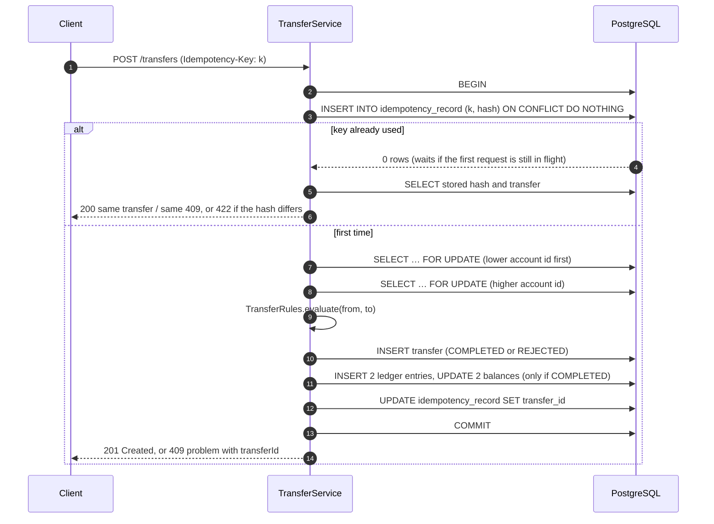

# Ledger Service

[](https://github.com/ilia-muravev-dev/ledger/actions/workflows/ci.yml)


[](LICENSE)

A small double-entry payments ledger that focuses on the parts of money movement that are easy to get
wrong: **correctness under concurrency, idempotent APIs, double-entry bookkeeping** and an independent
way to prove the books still balance.

> [!NOTE]
> This is a learning / portfolio project, not a production system. There is no authentication,
> no multi-tenancy and no regulatory tooling. See [What I would change for real scale](#what-i-would-change-for-real-scale).

## Contents

- [Quick start](#quick-start)
- [API](#api)
- [Invariants](#invariants)
- [How a transfer works](#how-a-transfer-works)
- [Design decisions](#design-decisions)
- [Pessimistic vs optimistic locking: benchmark](#pessimistic-vs-optimistic-locking-benchmark)
- [Testing](#testing)
- [What I would change for real scale](#what-i-would-change-for-real-scale)
- [Project layout](#project-layout)
- [Roadmap](#roadmap)

## Quick start

Requirements: Docker. For development also JDK 21.

```bash
docker compose up --build
```

The service listens on `http://localhost:8080`, PostgreSQL on `localhost:5432` (`ledger` / `ledger`).

```bash
./gradlew build          # compile + all tests (Testcontainers, needs Docker)
./gradlew bootTestRun    # run the service against a throwaway PostgreSQL container
./gradlew benchmark      # locking strategy benchmark, writes build/reports/benchmark/locking.md
```

Select the transfer engine with `LEDGER_LOCKING=pessimistic|optimistic` (default `pessimistic`).

## API

All amounts are integers in **minor units** of the currency (cents for EUR/USD, yen for JPY).

| Method | Path | Description |
|---|---|---|
| `POST` | `/accounts` | Open a customer account `{owner, currency}` |
| `GET` | `/accounts/{id}` | Account with its current balance |
| `POST` | `/accounts/{id}/close` | Close an account with a zero balance (idempotent) |
| `POST` | `/accounts/{id}/deposits` | Fund an account from the settlement account. Requires `Idempotency-Key` |
| `GET` | `/accounts/{id}/entries?limit=&cursor=` | Ledger entries, newest first, keyset pagination |
| `POST` | `/transfers` | Move money between two customer accounts. Requires `Idempotency-Key` |
| `GET` | `/transfers/{id}` | A transfer, completed or rejected |
| `GET` | `/actuator/reconciliation` | Recompute every balance from the entries and report discrepancies |

### Example session

```bash
curl -s -X POST localhost:8080/accounts \
  -H 'Content-Type: application/json' \
  -d '{"owner":"Alice","currency":"EUR"}'
```

```json
{"id":"89d9f70d-9726-458f-b024-076997cc179c","owner":"Alice","currency":"EUR","type":"CUSTOMER","status":"ACTIVE","balance":0,"createdAt":"2026-11-08T09:23:01.949639Z"}
```

Fund it (money enters the ledger from the EUR settlement account, see [settlement accounts](#settlement-accounts)):

```bash
curl -s -X POST localhost:8080/accounts/$ALICE/deposits \
  -H 'Content-Type: application/json' -H 'Idempotency-Key: dep-1' \
  -d '{"amount":10000,"currency":"EUR"}'
```

Transfer €25.00 to Bob:

```bash
curl -s -i -X POST localhost:8080/transfers \
  -H 'Content-Type: application/json' -H 'Idempotency-Key: t-1' \
  -d "{\"fromAccountId\":\"$ALICE\",\"toAccountId\":\"$BOB\",\"amount\":2500,\"currency\":\"EUR\"}"
```

```http
HTTP/1.1 201
Location: http://localhost:8080/transfers/cc09b34d-a1a5-4272-8ba9-7c5580b17094

{"id":"cc09b34d-a1a5-4272-8ba9-7c5580b17094","type":"TRANSFER","fromAccountId":"89d9f70d-…","toAccountId":"395b1dcf-…","amount":2500,"currency":"EUR","status":"COMPLETED","createdAt":"2026-11-08T09:23:02.416407Z"}
```

Sending the exact same request again returns `200` with the same transfer; no money moves. Reusing the
key with a different body:

```http
HTTP/1.1 422
Content-Type: application/problem+json

{"type":"/problems/idempotency-key-reused","title":"Idempotency key was used with a different request","status":422,"detail":"Idempotency key 't-1' was already used with a different request","instance":"/transfers","idempotencyKey":"t-1"}
```

Spending more than the balance:

```http
HTTP/1.1 409
Content-Type: application/problem+json

{"type":"/problems/insufficient-funds","title":"Insufficient funds","status":409,"detail":"Transfer 2026d96f-… was rejected: INSUFFICIENT_FUNDS","instance":"/transfers","transferId":"2026d96f-…","reason":"INSUFFICIENT_FUNDS"}
```

Account statement, one entry per page:

```bash
curl -s "localhost:8080/accounts/$ALICE/entries?limit=1"
```

```json
{"items":[{"id":3,"transferId":"cc09b34d-…","amount":-2500,"currency":"EUR","createdAt":"2026-11-08T09:23:02.416407Z"}],"nextCursor":"ZTE6Mw"}
```

Reconciliation:

```bash
curl -s localhost:8080/actuator/reconciliation
```

```json
{"checkedAt":"2026-11-08T09:23:02.614851Z","consistent":true,"accountsChecked":3,"transfersChecked":3,"balanceMismatches":[],"unbalancedCurrencies":[],"malformedTransfers":[]}
```

### Errors

Every error is an [RFC 7807](https://www.rfc-editor.org/rfc/rfc7807) problem (`application/problem+json`) with a stable `type`:

| Status | `type` | When |
|---|---|---|
| 400 | `/problems/validation-failed` | Malformed body, missing or oversized `Idempotency-Key`, amount ≤ 0, `from = to`, unknown currency, bad cursor |
| 404 | `/problems/account-not-found`, `/problems/transfer-not-found` | Unknown id |
| 409 | `/problems/insufficient-funds` | Balance lower than the amount |
| 409 | `/problems/account-closed` | Either account is `CLOSED` |
| 409 | `/problems/currency-mismatch` | Accounts or amount in different currencies |
| 409 | `/problems/settlement-account-not-allowed` | A customer transfer touching a settlement account |
| 409 | `/problems/account-not-empty` | Closing an account with money on it |
| 422 | `/problems/idempotency-key-reused` | Same key, different request |
| 503 | `/problems/contention` | Optimistic engine ran out of retries; `Retry-After: 1` |

## Invariants

Each invariant is enforced in code, backed by a database constraint where possible, and has tests on
real PostgreSQL.

| # | Invariant | Enforced by | Tested in |
|---|---|---|---|
| 1 | Every completed transfer creates exactly two entries that sum to zero; rejected transfers create none | `LedgerEntryRepository.insertDoubleEntry` | `TransferInvariantsIT`, reconciliation |
| 2 | The sum of all entries is zero per currency | double entry + settlement accounts | `TransferInvariantsIT`, `TransferConcurrencyContract`, reconciliation |
| 3 | A customer balance never goes below zero | `TransferRules` on locked / versioned rows; `account_balance_check` | `TransferInvariantsIT`, 100-thread drain test |
| 4 | Transfers only between `ACTIVE` accounts in the same currency, amount > 0, `from ≠ to` | `TransferRules`, `TransferCommand`; `transfer_amount_check`, `transfer_distinct_accounts_check` | `TransferRulesTest`, `TransferCommandTest`, `TransferInvariantsIT`, `SchemaConstraintsIT` |
| 5 | The same idempotency key never moves money twice and always returns the original result | key claimed first under a unique index | `IdempotencyIT`, 20-thread same-key test |
| — | Cached balance = sum of the account's entries | balances only change in the transfer transaction | `TransferInvariantsIT`, `ReconciliationIT`, every concurrency test |

## How a transfer works



## Design decisions

### Money in minor units

`Money` is a `long` number of minor units plus a `java.util.Currency`. There is no `double`, `float` or
`BigDecimal` in the money path, so there is no rounding to reason about, and arithmetic uses
`Math.addExact` and friends so an overflow throws instead of wrapping into a negative balance.
`BigDecimal` is used only to format amounts for humans.

### Balances are derived from entries

The source of truth is `ledger_entry`: append-only, signed amounts, debit negative, credit positive.
`account.balance` is a cache that only changes inside the same transaction that writes the entries,
which makes `GET /accounts/{id}` and the overdraft check O(1) without trusting the cache blindly:
`/actuator/reconciliation` recomputes every balance from the entries in a single `REPEATABLE READ`
snapshot and also checks the per-currency zero sum and the shape of every transfer.

### Settlement accounts

A closed ledger cannot create money, yet accounts need funding. Deposits are ordinary transfers from a
per-currency `SETTLEMENT` account — the only account type allowed to go negative. Its balance is the
mirror image of all customer money in that currency, so "all entries sum to zero" holds at all times.
Customer transfers may not touch settlement accounts.

### Rejected transfers are recorded

A transfer that fails a business rule (insufficient funds, closed account, currency mismatch) is stored
as `REJECTED` with a reason and the API answers `409` with its `transferId`. Without that, a client
retrying a failed payment after the account was topped up would silently get a *successful* payment for
the same idempotency key. Validation errors (`400`) and unknown accounts (`404`) are not recorded and do
not consume the key.

### Idempotency: claim the key first

`idempotency_record` has the key as its primary key. The transfer transaction starts with
`INSERT … ON CONFLICT DO NOTHING`. If another transaction holding the same key has not committed yet,
PostgreSQL makes the insert **wait on the unique index** until it commits or rolls back — so two
concurrent requests with the same key serialise on the key alone, never both proceed, and the loser
reads the winner's result. A SHA-256 of the canonical request (type, accounts, amount, currency) detects
key reuse with a different body (`422`). Claiming the key before taking account locks means duplicate
retries do not queue behind traffic on hot accounts.

### Lock ordering

The pessimistic engine locks both accounts with `SELECT … FOR UPDATE` in a global order (by id). A→B
and B→A therefore always lock the same row first and can never wait on each other in a cycle. Removing
the ordering makes `opposingTransfersDoNotDeadlock` fail with PostgreSQL `deadlock detected`; removing
`FOR UPDATE` makes the 100-thread drain test overdraw — both checked while writing the tests.

### Optimistic alternative

`OptimisticTransferEngine` reads both accounts without locks and applies `UPDATE … WHERE version = ?`
in the same id order. Zero rows updated means someone else got there first: the whole transaction is
rolled back and retried with exponential backoff and full jitter, up to `max-attempts` (default 30),
after which the API answers `503` with `Retry-After`. Retries hold no database connection while
sleeping.

The versioned updates run **before** the transfer and its entries are inserted. The first version did
it the other way round and, under contention, PostgreSQL itself failed with
`new multixact has more than one updating member` (on 16.15 and 18): the foreign keys had already taken
`KEY SHARE` locks on rows that other transactions were updating. Updating first means a transaction
only key-shares rows it already owns, and a losing attempt aborts before writing anything. Details in
[#26](https://github.com/ilia-muravev-dev/ledger/issues/26).

### Constraints in the database as well as in code

The rules live in Java, but the schema rejects the states that would break an invariant even if a bug
got through: `balance >= 0` for customer accounts, `amount > 0`, `from <> to`, "a reason if and only
if rejected", one settlement account per currency. `SchemaConstraintsIT` proves each one.

### jOOQ generated from the migrations

jOOQ classes are generated at build time from the Flyway scripts with `DDLDatabase`, so the build needs
no running database and the code can never drift from the schema. Enum columns are mapped straight to
the domain enums.

## Pessimistic vs optimistic locking: benchmark

Same harness for both engines (`LockingBenchmark`), calling the engine directly so HTTP is not
measured. 32 client threads, Hikari pool of 20, 5,000 transfers of 1 cent per run after 500 warm-up
transfers, PostgreSQL 16 in Testcontainers. Apple M1 Pro (8 cores), Docker via OrbStack with 8 CPUs.
Latency includes retries and waiting for a pool connection.

| Scenario | Strategy | Throughput (transfers/s) | p50 (ms) | p99 (ms) | Conflicts / transfer | Gave up |
|---|---|---:|---:|---:|---:|---:|
| Hot pair: 2 accounts, both directions | pessimistic | 401 | 77.6 | 167.2 | 0.00 | 0 |
| Hot pair: 2 accounts, both directions | optimistic | 332 | 3.3 | 1329.7 | 2.82 | 64 |
| Hot source: 1 account pays 100 others | pessimistic | 469 | 49.6 | 280.1 | 0.00 | 0 |
| Hot source: 1 account pays 100 others | optimistic | 343 | 2.9 | 1404.9 | 2.50 | 105 |
| Uniform: 1,000 accounts | pessimistic | 2,411 | 8.1 | 132.6 | 0.00 | 0 |
| Uniform: 1,000 accounts | optimistic | 2,112 | 8.9 | 134.4 | 0.06 | 0 |

**Reading the numbers**

- **Under contention, pessimistic wins on everything that matters for payments.** Transfers on a hot
  account are serialised either way; row locks serialise them in a queue, while optimistic locking
  lets every attempt do its reads and then throws all but one away. That costs ~20% throughput, an
  order of magnitude worse p99, and 1–2% of transfers that give up after 30 attempts.
- **Optimistic has the better median under contention** (3 ms vs 50–78 ms): whoever wins does not
  wait at all. The cost is pushed into a long, unfair tail — some requests retry many times while
  newcomers get through.
- **With low contention they are equivalent** (0.06 conflicts per transfer). The p99 there is
  dominated by waiting for one of the 20 pool connections, not by locking.
- Optimistic locking would be the better fit where conflicts are rare and holding a lock is expensive
  (long transactions, user think-time between read and write). A ledger with hot merchant or
  treasury accounts is the opposite, so pessimistic is the default.

Numbers vary between runs by roughly ±15%; the ordering does not change. Reproduce with
`./gradlew benchmark` (`-Dbenchmark.threads=…`, `-Dbenchmark.transfers=…`).

## Testing

```bash
./gradlew build
```

runs ~150 tests: unit tests for the domain and integration tests against PostgreSQL 16 via
Testcontainers, sharing one container through Spring's test context cache. CI runs the same command on
every push to `main` and every pull request, and builds the Docker image.

| Area | Tests |
|---|---|
| Domain rules | `MoneyTest`, `TransferCommandTest`, `TransferRulesTest`, `EntryCursorTest`, `RetryPolicyTest` |
| Schema safety net | `SchemaConstraintsIT` |
| API + invariants | `AccountsApiIT`, `AccountLifecycleIT`, `TransferInvariantsIT`, `IdempotencyIT`, `StatementApiIT` |
| Concurrency | `TransferConcurrencyContract`, run by `PessimisticConcurrencyIT` and `OptimisticConcurrencyIT` |
| Reconciliation | `ReconciliationIT` (also detects deliberately corrupted balances and one-sided entries) |

The concurrency contract runs the same four scenarios against both engines:

- 100 threads drain one account at once → exactly 50 succeed, the balance ends at zero, never negative, money conserved
- 40 threads run A→B and B→A in parallel → no deadlock, all 400 transfers complete
- 20 threads send the same idempotency key → one transfer, every caller sees the same id
- 32 threads run random transfers across 8 accounts → money conserved and reconciliation is clean

## What I would change for real scale

- **Hot accounts.** One row lock per account caps a single merchant at a few hundred transfers per
  second. Real systems split hot accounts into sub-accounts (sharded balances) or batch their entries
  asynchronously.
- **Partitioning.** `ledger_entry` grows forever: partition by time, archive old partitions, and keep
  the cached balance plus periodic balance snapshots so reconciliation does not scan everything.
- **Idempotency record lifetime.** Keys are kept forever here; production would expire them after a
  retention window and scope them per client.
- **Events.** Publishing transfer events reliably needs a transactional outbox, not a dual write —
  planned in [#12](https://github.com/ilia-muravev-dev/ledger/issues/12).
- **Multi-currency.** Cross-currency transfers need an FX rate snapshot and FX position accounts so that
  each currency still sums to zero — [#14](https://github.com/ilia-muravev-dev/ledger/issues/14).
- **Security and operations.** Authentication and per-account authorisation, rate limiting, audit
  trail, metrics and alerting on reconciliation results, a read replica for statements.

## Project layout

```
src/main/java/dev/iliamuravev/ledger
├── domain/           Money, Account, Transfer, TransferCommand, TransferRules — no Spring
├── account/          accounts API, repository (jOOQ), service
├── transfer/         TransferEngine (pessimistic, optimistic), idempotency, API
├── ledger/           ledger entries and the paginated statement
├── reconciliation/   reconciliation service + /actuator/reconciliation
├── api/              RFC 7807 problem types and the exception handler
└── config/           clock
src/main/resources/db/migration   Flyway migrations (also the input for jOOQ code generation)
```

## Roadmap

Phase 2 is tracked in the [v0.2 milestone](https://github.com/ilia-muravev-dev/ledger/milestone/2):
transactional outbox → Kafka with a CQRS account statement, k6 load tests with Micrometer and Grafana,
multi-currency transfers with FX snapshots, and a small React + TypeScript UI with live balances.

## License

[MIT](LICENSE)
